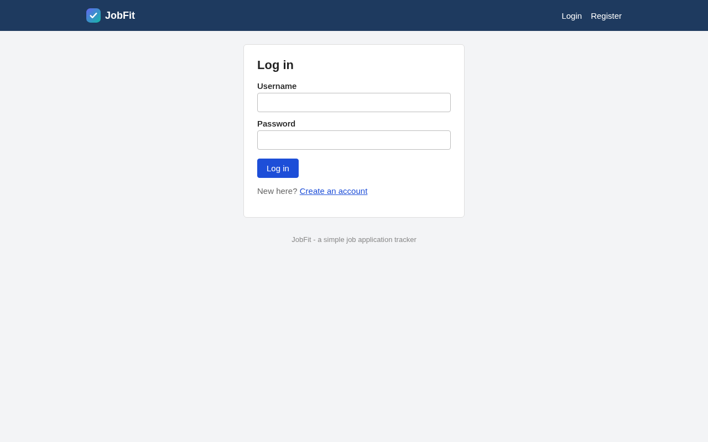
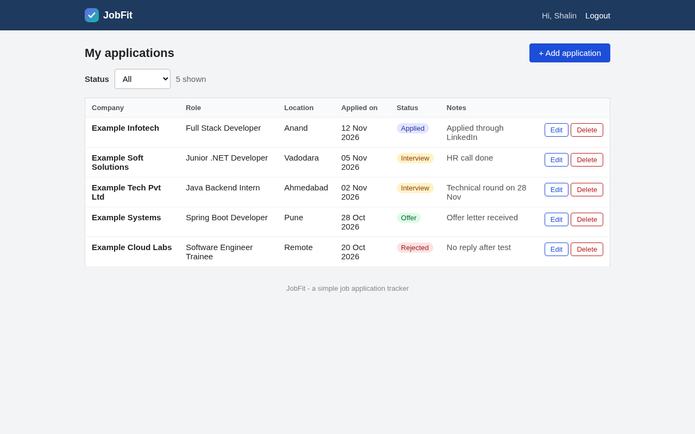
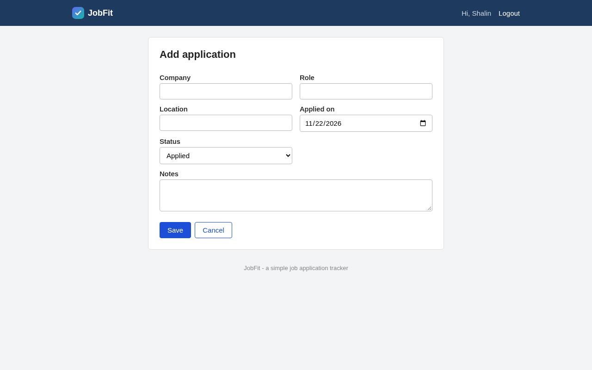
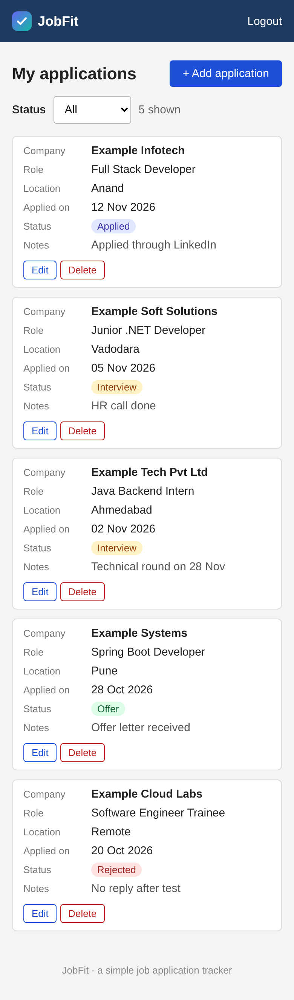

<p align="center"></p>
<h1 align="center">JobFit</h1>
<p align="center"><b>A simple job application tracker.</b></p>

JobFit keeps track of the jobs I apply to. You make an account, add each application (company, role, location, date, status and notes), and update the status as it moves from Applied to Interview, Offer or Rejected.

## Screenshots

| Login | My applications |
|---|---|
|  |  |
| **Add application** | **Phone** |
|  |  |

The companies in the screenshots are example data.

## Features

- Register, log in and log out (login is kept in Session)
- Add, edit and delete applications
- Filter the list by status
- Each user only sees their own applications
- Passwords are stored as hashes, not plain text

## Tech used

- C# and ASP.NET Core 8 MVC
- SQL Server (LocalDB) with ADO.NET: `SqlConnection` and `SqlCommand` with parameters
- Plain HTML and CSS

## Database

Two tables: `Users` and `Applications`. The script is in [`Database/JobFit.sql`](Database/JobFit.sql).

## How to run

1. Open `JobFit.sln` in Visual Studio 2022.
2. Open SQL Server Object Explorer, connect to `(localdb)\MSSQLLocalDB`, and run `Database/JobFit.sql`.
3. Check the connection string in `JobFit/appsettings.json`.
4. Press F5. The app opens at `http://localhost:5080`.

## Project structure

```
JobFit/
  Controllers/   AccountController, ApplicationsController
  Models/        JobApplication, RegisterModel, LoginModel
  Helpers/       PasswordHelper
  Views/         Account, Applications, Shared/_Layout
  wwwroot/css/   site.css
Database/
  JobFit.sql
```
