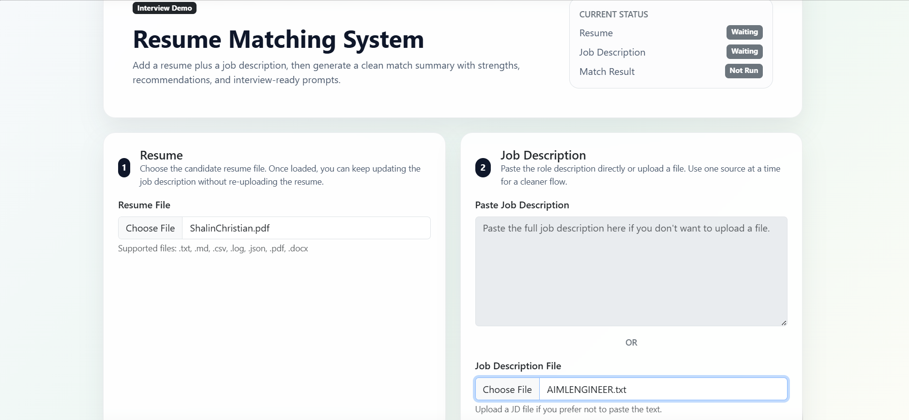
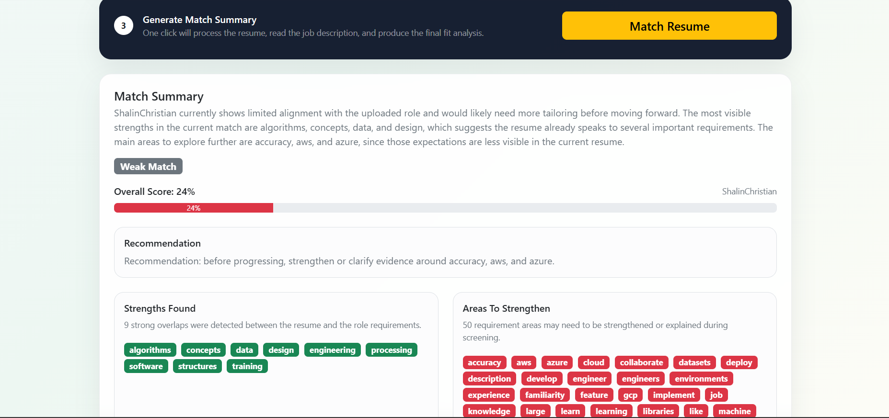

# 📄 Resume Matching System


---

## 🚀 Overview
The **Resume Matching System** is an intelligent application designed to automate the process of matching resumes with job descriptions. It uses **Natural Language Processing (NLP)** and machine learning techniques to evaluate candidate suitability and rank resumes based on relevance.

This tool helps recruiters **save time**, **reduce manual screening effort**, and **improve hiring accuracy**.

---

## ✨ Features

- 🔍 **Keyword Extraction**  
  Automatically identifies key skills, qualifications, and requirements from resumes and job descriptions.

- 📊 **Resume Ranking System**  
  Scores and ranks resumes based on similarity and relevance.

- 📈 **Matching Visualization**  
  Provides clear visual insights into how well a resume matches the job description.

- 💡 **Improvement Suggestions**  
  Offers actionable recommendations to enhance resume quality.

---

## 🛠️ Tech Stack

| Category     | Technologies Used              |
|--------------|------------------------------|
| **Backend**  | Python, Flask                |
| **ML**       | Scikit-learn                 |
| **NLP**      | NLTK                         |
| **Frontend** | HTML, CSS, JavaScript        |
| **Deployment** | Docker                    |

---


## 📸 Screenshots

### 🏠 Homepage


### 📊 Matching Result


---

## ⚙️ Installation & Setup

### 🔹 Option 1: Run with Docker (Recommended)

1. **Clone the repository**
   ```bash
   git clone https://github.com/shalinchristian/ResumeMatchingSystem.git
   cd ResumeMatchingSystem
   ```

2. **Build Docker Image**
   ```bash
   docker build -t resume-matcher .
   ```

3. **Run the Container**
   ```bash
   docker run -p 5000:5000 resume-matcher
   ```

4. **Open in browser**
   ```
   http://localhost:5000
   ```

---

### 🔹 Option 2: Run without Docker

1. **Clone the repository**
   ```bash
   git clone https://github.com/shalinchristian/ResumeMatchingSystem.git
   cd ResumeMatchingSystem
   ```

2. **Create virtual environment (recommended)**
   ```bash
   python -m venv venv
   ```

   - Windows:
     ```bash
     venv\Scripts\activate
     ```
   - Mac/Linux:
     ```bash
     source venv/bin/activate
     ```

3. **Install dependencies**
   ```bash
   pip install -r requirements.txt
   ```

4. **Run the application**
   ```bash
   python app.py
   ```

5. **Open in browser**
   ```
   http://localhost:5000
   ```

---

## 🧠 How It Works

1. **Upload** a resume (PDF/DOCX)  
2. **Paste** the job description  
3. **Click Match**

### 🔄 Processing Steps:
- Text preprocessing  
- Feature extraction  
- Similarity scoring  

### 📊 Output:
- Match score  
- Ranking  
- Suggestions  

---

## 🤝 Contribution

Contributions are welcome!

1. Fork the repository  
2. Create a new branch  
3. Commit your changes  
4. Submit a Pull Request  

> For major changes, please open an issue first.

---

## 📜 License

This project is licensed under the MIT License.  
See the `LICENSE` file for details.

---

## 📬 Contact

**Shalin Christian**  
📧 shalinchristian71@gmail.com