<p align="center"></p>
<h1 align="center">JobFit</h1>
<p align="center"><b>Paste a job posting. See if you're ready to apply.</b></p>

JobFit is a small tool for job seekers. You upload your resume and paste a job posting. It gives you a fit score, the skills you have and the ones you're missing, one concrete action for each gap, interview questions to practice, and a tracker for the jobs you've checked.

It pairs with **Resqora**, the resume builder: build your resume in Resqora, then check it against real postings in JobFit.

## Screenshots

| Check a job | Fit result |
|---|---|
| 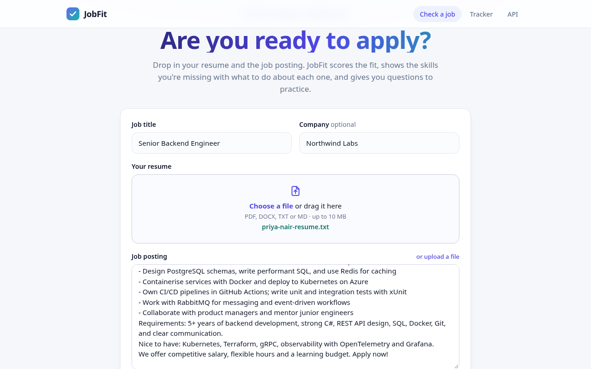 | 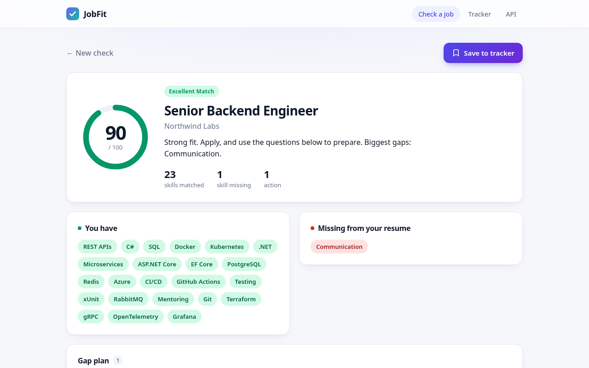 |
| **Gap plan** | **Tracker** |
| 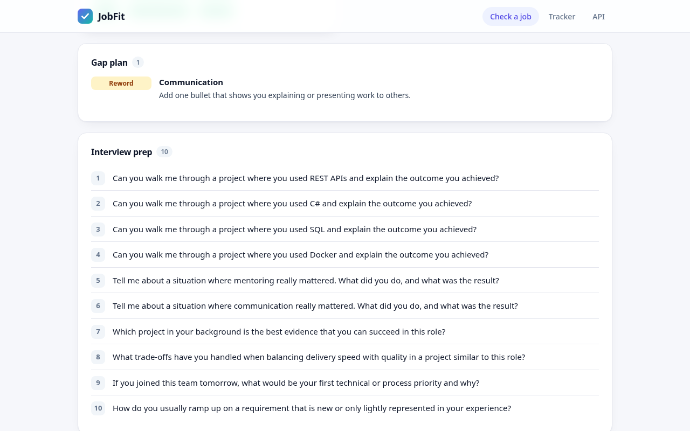 | 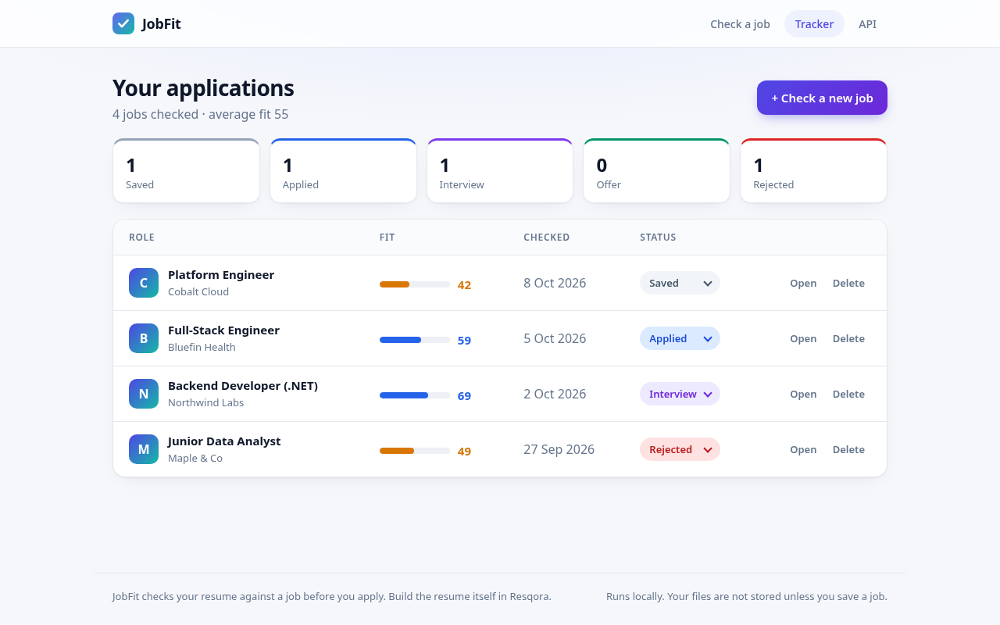 |
| **Saved job detail** | **Works without Python (quick score)** |
| 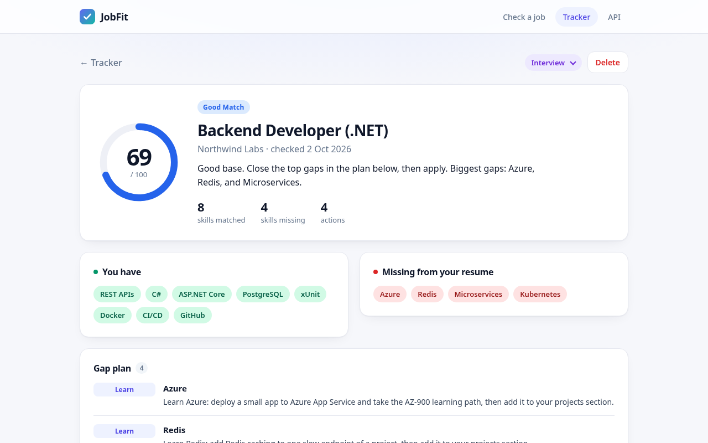 | 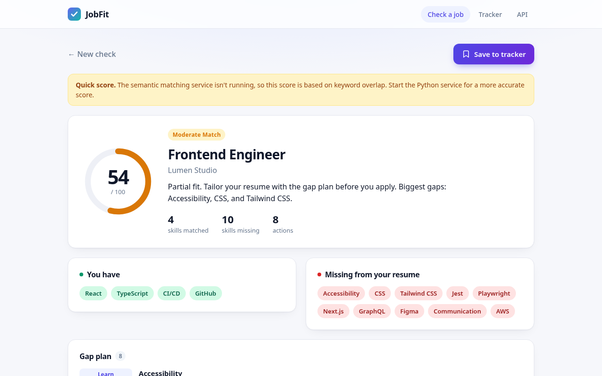 |
| **Frontend posting (React)** | **Data analyst posting** |
| 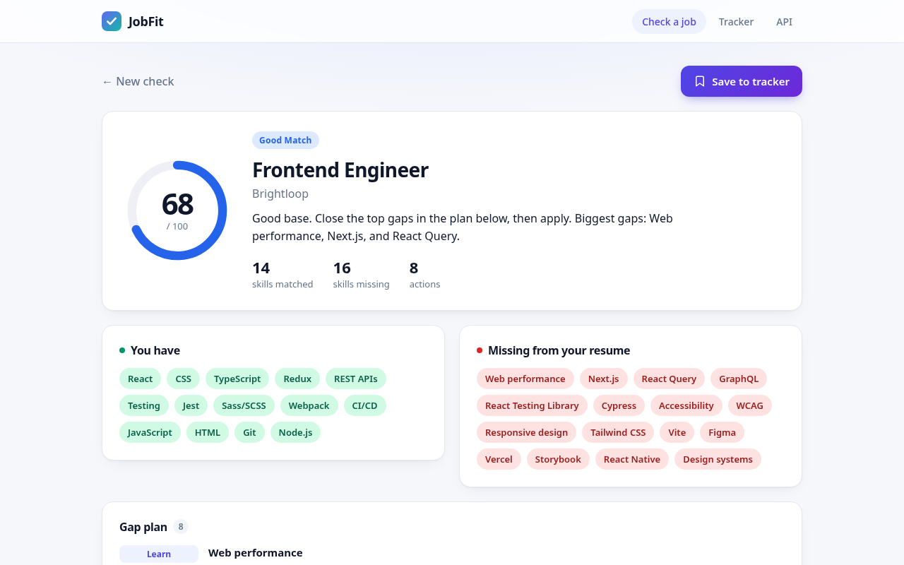 | 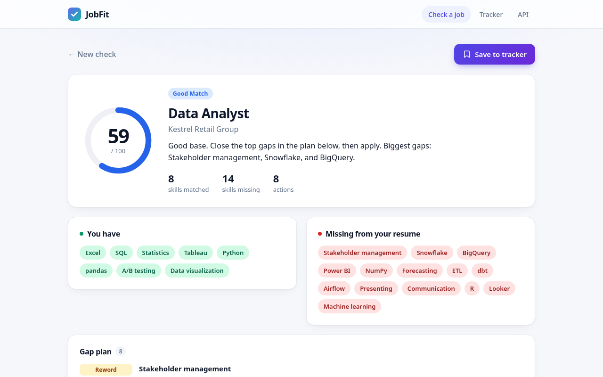 |
| **Android posting** | **SRE posting** |
| 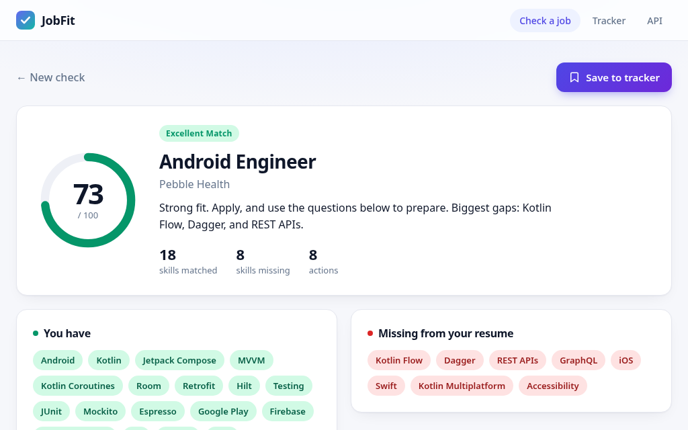 | 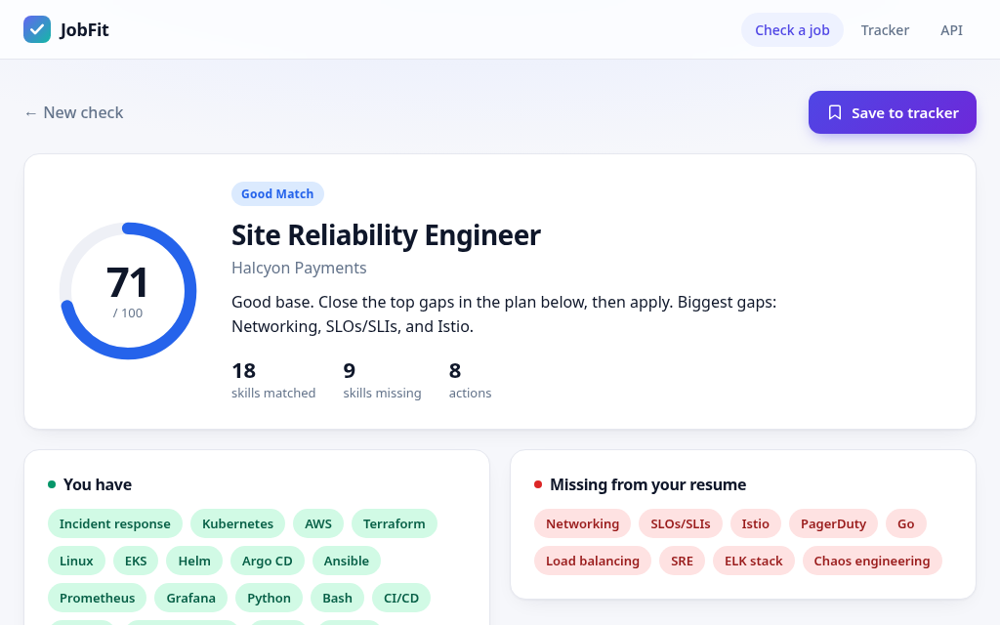 |
| **REST API (Swagger)** | **Mobile** |
| 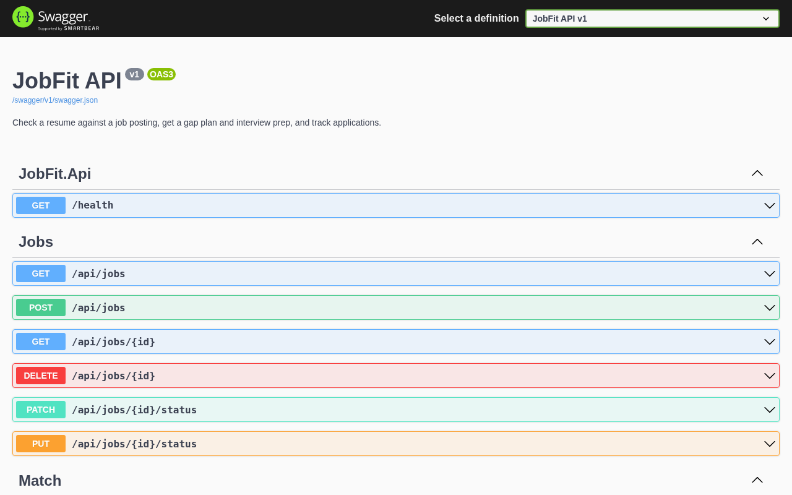 | 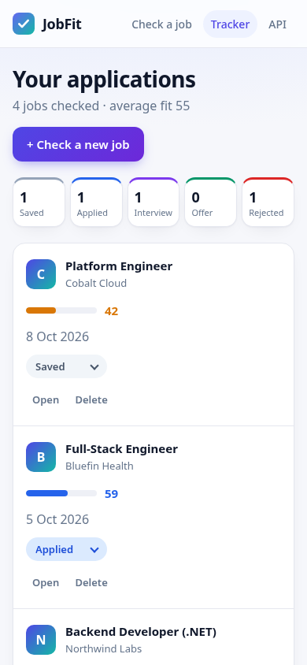 |

All data in the screenshots is fictional (sample resumes and postings in `docs/sample/`, demo jobs from `DemoSeeder`). The result screenshot uses `docs/sample/priya-nair-resume.txt` against `docs/sample/senior-backend-engineer-posting.txt`, scored by the real model.

## Features

- **Fit check.** Upload a resume (PDF, DOCX, TXT or MD, up to 10 MB), paste or upload the posting, and add the job title and company. You get a 0–100 score with a label, plus matched and missing skills sorted by how often the posting mentions them. **Only skills from the built-in catalog are shown.** It has about 170 skills, including Android and SRE. Specific tools count toward broader skills (Jenkins counts as CI/CD, EF Core as .NET, EKS as Kubernetes). Skill names that are also everyday words (Go, R, C, Swift, Excel, Room, Flow and others) are matched by case and context, so "go live" or "excel at" never count. Aliases are included across backend, frontend, data, cloud and DevOps, plus a few soft skills. Random words from the posting are never shown as skills, gaps or questions. Skills like *ASP.NET Core*, *Node.js* and *CI/CD* are recognized whole, plurals and tenses are normalized (APIs → API, mentored → mentor), and company, title, city and job-ad filler words ("salary", "hybrid", "senior"...) are ignored.
- **Gap plan.** For the top 8 missing skills you get one line each. The rules are deterministic, with no AI and no external API:
  - **Show a project:** a *curated* related skill is on your resume (MySQL ↔ PostgreSQL ↔ SQL Server, React ↔ Vue ↔ Angular, AWS ↔ Azure ↔ GCP, Docker → Kubernetes...). Anything not in the map falls back to Learn.
  - **Learn:** the skill is new to you, so you get a specific small project to try.
  - **Reword:** only for soft skills in the catalog (communication, leadership, mentoring, stakeholders, presenting, problem solving).
- **Interview prep.** Up to 10 questions, built only from catalog skills. You get "walk me through a project" questions for your top matched skills and "this role values X" for top gaps. Soft skills get behavioral questions. "The posting also mentions X" is only asked for skills you don't already have.
- **Tracker.** Save a check and follow it through Saved, Applied, Interview, Offer and Rejected. You can change the status, open the detail page or delete a job. Jobs are stored in SQLite (`jobfit.db`), so they survive restarts.
- **Works without Python.** If the semantic service is down, JobFit uses a C# keyword-overlap score in place of the model, blended with skill coverage the same way, so it lands within about 5 points of the model score, and shows a small "Quick score" notice.
- **Private by default.** Resumes from the web UI are not stored. Only jobs you save go into the local database.

## Tech stack

| Part | Tech |
|---|---|
| Web app + API | C# / ASP.NET Core 8 (MVC Razor views + Web API controllers), Swagger (Swashbuckle) |
| Data | EF Core 8 with SQLite (app) and the InMemory provider (tests) |
| File parsing | UglyToad.PdfPig (PDF), DocumentFormat.OpenXml (DOCX) |
| Semantic score | Python 3.10, Flask, sentence-transformers `all-MiniLM-L6-v2`, scikit-learn cosine similarity |
| Frontend | Plain HTML/CSS/JS: no build step, no CDN, no remote fonts |
| Tests | xUnit, Moq, FluentAssertions, `Microsoft.AspNetCore.Mvc.Testing`; pytest |
| Deploy | Docker + Docker Compose |

## How the score works

1. **Semantic half.** The Python service embeds the resume and the posting with `all-MiniLM-L6-v2` and returns their cosine similarity × 100.
2. **Skill half.** The C# side finds the posting's catalog skills that the resume has and the ones it's missing. Specific tools count toward broader skills, so Jenkins counts as CI/CD and Rails counts as Ruby. Coverage is matched ÷ all of the posting's catalog skills.
3. **Blend.** `ScoreBlend`: `score = 0.5 × semantic + 0.5 × 100 × √coverage`. The square root gives more credit for the first skills than for the last few, so 18 of 26 skills (69%) adds 83 points, not 69. If the posting names no catalog skills, only the semantic score is used. The API also returns `semanticScore` and `skillCoverage`.
   The score is rounded **once** to a whole number (`ScoreBands.Round`, so 71.6 becomes 72 and is Excellent). One set of cut-offs (`ScoreBands`) then drives the label, the summary, the colors and the API's recommendation. Saved jobs get their label recomputed from the score every time they're read, so rows from older versions never show a stale label. Real-model results on QA's postings:

   | Pair | Semantic | Skills | Score |
   |---|---|---|---|
   | Strong backend resume, backend posting | 81.5 | 23/24 | 90 Excellent |
   | Near-complete Android resume, Android posting | 63.1 | 18/26 | 73 Excellent |
   | Medium backend resume, backend posting | 65.2 | 6/24 | 58 Good |
   | Weak resume, backend posting | 28.4 | 1/24 | 24 Weak |

   | Score | Label | Summary |
   |---|---|---|
   | ≥ 72 | Excellent Match | Strong fit |
   | 55–71 | Good Match | Good base |
   | 40–54 | Moderate Match | Partial fit |
   | 20–39 | Weak Match | Long shot |
   | < 20 | Poor Match | Long shot |
4. **Quick score.** If Python can't be reached, `FallbackScorer` stands in for the semantic half with `20 + 65 × sqrt(0.8 × weighted skill coverage + 0.2 × word coverage)`, refit against the model. The result is then blended exactly like the model score. On QA's 11 pairs, the blended quick score is within 5 points of the model score (2.9 on average). 9 of the 11 pairs get the same label; the other 2 sit near a cut-off.

## Project structure

```
JobFit.sln
src/
  JobFit.Api/              ASP.NET Core 8: MVC pages, API controllers, Program.cs, DemoSeeder, Dockerfile
    Controllers/           HomeController (check/result/save), TrackerController, JobsController (/api/jobs),
                           MatchController (/api/match), ResumeController (/api/resume)
    Views/                 Home/Index, Home/Result, Tracker/Index, Tracker/Details, Shared/_Layout, _FitResult
    wwwroot/               css/site.css, js/site.js, img/logo.svg
  JobFit.Core/             Models, DTOs, MatchService, KeywordExtractor, SkillCatalog, GapPlanBuilder,
                           FallbackScorer, MatchInsightsBuilder, JobTrackerService, repository interfaces
  JobFit.Infrastructure/   AppDbContext (SQLite/InMemory), JobRepository, ResumeRepository,
                           SimilarityClient (HTTP to Python), DocumentTextExtractor, PythonServiceHealthCheck
services/nlp/              Python Flask similarity service (+ pytest, model faked in tests)
tests/JobFit.Tests/        xUnit unit + API integration tests
docs/screenshots/          README images        docs/sample/   fictional resume + posting for trying it out
```

## Run locally

Requirements: .NET 8 SDK, and optionally Python 3.10–3.13. A fresh Python 3.13 venv install was verified. Install CPU-only torch first with `pip install torch --index-url https://download.pytorch.org/whl/cpu` to skip the large CUDA wheels.

```bash
# 1) Optional: the semantic similarity service (downloads ~80 MB model on first request)
cd services/nlp
python -m venv .venv && source .venv/bin/activate
pip install -r requirements.txt
python app.py                       # http://localhost:5001

# 2) The app (works without step 1, using the quick keyword score)
dotnet run --project src/JobFit.Api # http://localhost:5000
# with 4 fictional demo jobs in the tracker:
dotnet run --project src/JobFit.Api -- --Demo:Seed=true
```

Open http://localhost:5000 for the app and http://localhost:5000/swagger for the API. Try it with `docs/sample/alex-rivera-resume.txt` and `docs/sample/frontend-engineer-posting.txt`.

Configuration (`appsettings.json` or environment variables):

| Key | Default | Meaning |
|---|---|---|
| `PythonService:BaseUrl` | `http://localhost:5001` | Similarity service |
| `ConnectionStrings:JobFit` | `Data Source=jobfit.db` | SQLite file for the tracker |
| `Database:Provider` | `Sqlite` | Set to `InMemory` to keep nothing on disk |
| `Demo:Seed` | `false` | Seed demo jobs when the tracker is empty |

### Docker Compose

```bash
docker compose up --build   # app on :5000, Python (gunicorn) on :5001
# The tracker DB lives in the jobfit-data volume, and the HF model cache in hf-cache (downloaded once).
# The app waits for the Python healthcheck. To bake the model into the image instead:
docker compose build --build-arg PRELOAD_MODEL=1 nlp
```

## API

| Method | Route | What it does |
|---|---|---|
| `GET` | `/api/jobs` | List tracked jobs, newest first |
| `POST` | `/api/jobs` | Run a fit check on `{title, company, resumeText, jobDescription, status?}` and save it |
| `GET` | `/api/jobs/{id}` | One job with skills, gap plan and interview questions |
| `PATCH` / `PUT` | `/api/jobs/{id}/status` | `{ "status": "Saved" \| "Applied" \| "Interview" \| "Offer" \| "Rejected" }` |
| `DELETE` | `/api/jobs/{id}` | Remove a job |
| `POST` | `/api/match/text` | Fit check on `{resumeText, jobDescription, company?, title?}` without saving (score, skills, gap plan, questions, `usedFallback`) |
| `POST` | `/api/resume/upload` | Store a resume (`{candidateName, content}`) for `/api/match` |
| `GET` | `/api/resume/{id}` | Resume preview |
| `POST` | `/api/match` | Match a stored resume `{resumeId, jobDescription}` |
| `GET` | `/health` | Liveness |

API bodies are limited to 10 MB, and each text field to 1,000,000 characters. Over either limit you get a JSON `413`.

There's a Postman collection in `JobFit.postman_collection.json`.

## Tests

```bash
dotnet test                                   # 230 xUnit tests
cd services/nlp && pip install -r requirements.txt -r requirements-dev.txt && pytest   # 6 tests, model is faked
```

The .NET tests cover score bands (label, summary, recommendation and tone agree), the tokenizer (phrases, word boundaries, stemming, filler, company/title filter, importance order, caps), the curated related-skill map, catalog-only interview questions, upload size and type limits (including a real multipart POST of a 16 MB file), the keyword extractor, the match service (including the fallback when Python is down, times out or returns bad data), the insight and summary builders, the gap plan builder, the fallback scorer, the tracker service and repository (EF InMemory), document parsing, and API integration tests through `WebApplicationFactory`. Those integration tests cover jobs CRUD, status changes, 400/404 responses, `/api/match/text` fallback, the pages and Swagger.

## History

JobFit was the **ResumeMatchingSystem** project, which was a recruiter-side resume-vs-job matcher. 

## License

MIT
